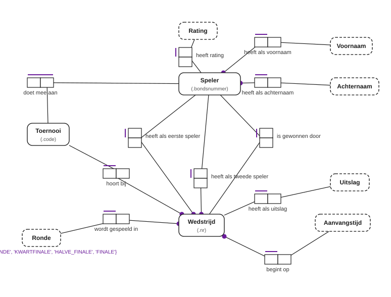

# Demo

## Tennistoernooi

Een klein, verzonnen voorbeeld. Een toernooi heeft spelers en wedstrijden. Een speler heeft een bondsnummer, een voornaam, een achternaam en soms een rating. Een wedstrijd heeft twee spelers, hoort bij een toernooi, wordt gespeeld in een ronde en heeft een aanvangstijd. Pas als de wedstrijd is gespeeld, zijn er een uitslag en een winnaar.

- **ORM-model**

    ---

    Het model in het formaat van Factum. Open het bestand in Visual Studio Code.

    [:octicons-mark-github-16: tennis-tournooi.orm.json](https://github.com/hans-blok/mim-datamodelling-demo/blob/main/demo/tennis-tournooi/02-conceptueel/tennis-tournooi.orm.json)

### Het model

Ronde mag alleen de waarden EERSTE_RONDE, KWARTFINALE, HALVE_FINALE en FINALE hebben.

### Feiten in gewone zinnen

| Feit | Uniek | Verplicht |
|---|---|---|
| Speler doet mee aan Toernooi | per combinatie | nee |
| Speler heeft als voornaam Voornaam | per speler | ja |
| Speler heeft als achternaam Achternaam | per speler | ja |
| Speler heeft rating Rating | per speler | nee |
| Wedstrijd hoort bij Toernooi | per wedstrijd | ja |
| Wedstrijd wordt gespeeld in Ronde | per wedstrijd | ja |
| Wedstrijd begint op Aanvangstijd | per wedstrijd | ja |
| Wedstrijd heeft als eerste speler Speler | per wedstrijd | ja |
| Wedstrijd heeft als tweede speler Speler | per wedstrijd | ja |
| Wedstrijd heeft als uitslag Uitslag | per wedstrijd | nee |
| Wedstrijd is gewonnen door Speler | per wedstrijd | nee |

## Relatie met MIM

Het ORM-model hoort bij het tweede niveau van MIM, het conceptuele informatiemodel. De tabel hieronder is een voorstel voor hoe de ORM-elementen zich verhouden tot de begrippen van MIM.

| ORM | Voorbeeld | MIM |
|---|---|---|
| Entiteitstype | Toernooi, Speler, Wedstrijd | Objecttype |
| Waardetype met een feittype naar een entiteitstype | Voornaam, Rating, Aanvangstijd | Attribuutsoort met een datatype |
| Feittype tussen twee entiteitstypen | Speler doet mee aan Toernooi | Relatiesoort |
| Waardebeperking op een waardetype | de vier waarden van Ronde | Enumeratie |
| Uniciteitsregel op een rol | een wedstrijd heeft één ronde | maximale kardinaliteit 1 |
| Verplichte rol | een wedstrijd heeft altijd een aanvangstijd | minimale kardinaliteit 1 |

!!! warning "Door AI voorgesteld, nog niet gecontroleerd"
    Deze tabel is een voorstel. Of Ronde een enumeratie is of een eigen objecttype met een waardenlijst, is een modelleerkeuze. Laat een deskundige de koppeling met MIM 1.2 controleren, bijvoorbeeld aan de hand van de [bronnen](../kennisbank/mim.md).
